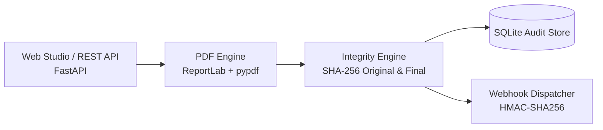

# Assinador Pro — Estúdio Web de Assinatura Eletrônica e Carimbo de PDFs

Aplicação web em **Python + FastAPI + pypdf + ReportLab + SQLite** para fluxo completo de assinatura eletrônica de documentos PDF: upload, carimbo visual em coordenadas configuráveis `(página, x, y)`, geração automática de **folha de auditoria criptográfica (SHA-256)**, verificação anti-adulteração e disparo de webhooks assinados com **HMAC-SHA256**.

## Arquitetura



## Principais Recursos

- **Carimbo Visual em PDF:** aplica bloco de assinatura (nome, e-mail, data/hora UTC e código de verificação) nas coordenadas escolhidas e anexa uma página de certificado de auditoria.
- **Verificação Anti-Adulteração (SHA-256):** recalcula o hash do PDF armazenado e compara com o registro imutável da assinatura no SQLite.
- **API REST + Interface Web:** pronta para rodar localmente com `uvicorn` (inclui documentação interativa OpenAPI em `/docs`).
- **Webhook Genérico com HMAC-SHA256:** notifica qualquer CRM ou ERP externo quando um documento é assinado.
- **Modo Demonstração (`--demo`):** gera um PDF fictício, executa a assinatura completa, anexa a folha de auditoria e valida o hash sem depender de arquivos externos.

## Como Executar

```bash
pip install -r requirements.txt

# 1. Demonstração ponta a ponta via CLI (gera e assina um PDF de exemplo)
python -m app.cli --demo

# 2. Inicia a interface web e API REST em http://127.0.0.1:8000
uvicorn app.main:app --reload

# 3. Executa os testes automatizados
pytest -v
```

## Estrutura do Projeto

```text
assinador-pro/
├── app/
│   ├── __init__.py
│   ├── cli.py          # Demonstração ponta a ponta via terminal
│   ├── database.py     # Persistência SQLite de documentos e trilha de auditoria
│   ├── main.py         # API REST FastAPI + interface web embutida
│   ├── pdf_engine.py   # Geração de carimbo visual, certificado e hash SHA-256
│   └── webhooks.py     # Assinatura HMAC-SHA256 para notificações externas
├── tests/
│   └── test_assinador.py
├── .env.example
├── .gitignore
├── LICENSE
└── requirements.txt
```
