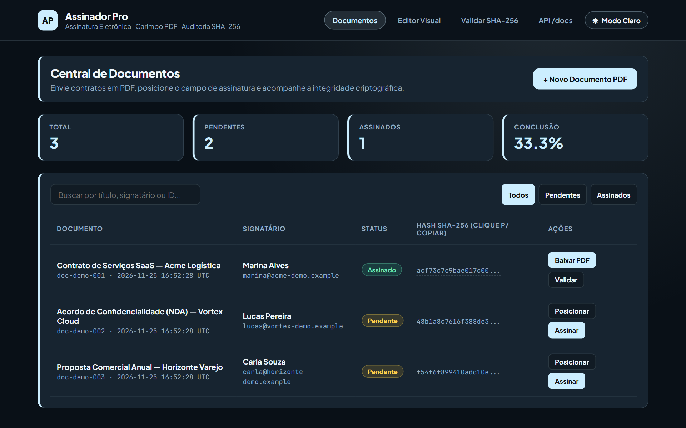

# Assinador Pro — Estúdio Web de Assinatura Eletrônica e Auditoria de PDFs



Aplicação web completa em **Python + FastAPI + PDF.js + pypdf + ReportLab + SQLite** para fluxo ponta a ponta de assinatura eletrônica de documentos PDF (com alternância **Modo Escuro / Modo Claro**):

- **Dashboard (`/`)**: KPIs em tempo real (Total, Pendentes, Assinados, Taxa de Conclusão), busca, filtros por status e tabela de ações.
- **Editor Visual de PDF (`/upload` e `/editor/{id}`)**: renderiza o PDF real no navegador com `PDF.js` e permite posicionar o campo de assinatura clicando diretamente sobre a página.
- **Portal do Signatário (`/sign/{id}`)**: prévia do PDF lado a lado com **canvas interativo para desenhar a assinatura à mão livre** (ou assinatura tipográfica), gravando a imagem PNG da assinatura dentro do PDF + página de certificado de auditoria.
- **Validador Público SHA-256 (`/validate`)**: verifica autenticidade e trilha de auditoria por ID, hash SHA-256 ou upload do arquivo PDF assinado.
- **API REST (`/docs`) + Webhooks HMAC-SHA256**: pronta para integração com qualquer CRM/ERP.

## Como Executar

```bash
pip install -r requirements.txt

# Inicia o estúdio web completo em http://127.0.0.1:8000 (já cria 3 documentos demo automaticamente)
uvicorn app.main:app --reload

# Executa os testes automatizados
pytest -v
```
